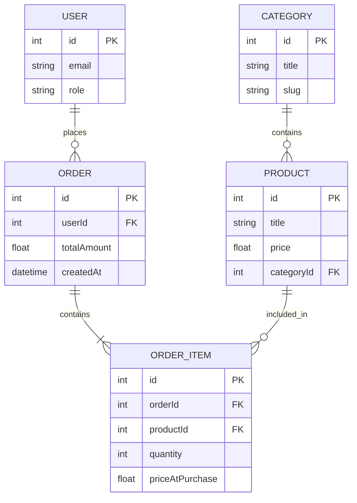

# express-monolith-starter (StarterKit-0)

Базовий початковий шаблон (StarterKit-0) для виконання **Лабораторної роботи №1** з дисципліни **«Технологія розробки Інтернет-застосунків»** (ХНТУ).

## 🚀 Швидкий старт

1. **Клонуйте репозиторій у власний GitHub-акаунт:**
   ```bash
   git clone <ваш-посилання-на-репозиторій>
   cd express-monolith-starter
   ```

2. **Встановіть залежності** (потрібен **Node.js 22 LTS**):
   ```bash
   node -v   # має бути v22.x
   npm install
   ```

3. **Налаштуйте змінні оточення:**
   ```bash
   cp .env.example .env
   ```

4. **Запустіть сервер у режимі розробки:**
   ```bash
   npm run dev
   ```

5. **Перевірте працездатність:**
   Відкрийте в браузері або Postman: `http://localhost:3000/api/v1/health`

## 📁 Структура проєкта (Початковий рівень ЛР 1)

```text
express-monolith-starter/
├── src/
│   ├── controllers/          # Папка для обробників запитів (ЛР 2)
│   ├── services/             # Папка для бізнес-логіки (ЛР 2, 4)
│   ├── repositories/         # Папка для запитів до БД (ЛР 4)
│   ├── routes/               # Папка для Express роутів (ЛР 2)
│   ├── middlewares/          # Папка для допоміжних файлів (ЛР 2, 5)
│   ├── types/                # TypeScript типи та інтерфейси
│   ├── app.ts                # Ініціалізація Express-застосунку
│   └── server.ts             # Точка входу та HTTP-слухач
├── .env.example              # Приклад зміних оточення
├── package.json              # Залежності проєкту
├── README.md                 # Опис предметної області та ERD
└── tsconfig.json             # Налаштування TypeScript
```

---

## 📦 Предметна область (Варіант N)

> **Назва системи:** «Інтернет-магазин побутової техніки» (монолітний веб-застосунок).
>
> **Призначення:** облік користувачів, каталогу товарів, категорій товарів, оформлених замовлень та позицій цих замовлень.

### Сценарій роботи

1. Користувач (**User**) реєструється в системі та отримує роль (`customer` або `admin`).
2. Адміністратор наповнює каталог: створює **категорії** (Category) і додає до них **товари** (Product).
3. Користувач переглядає каталог, додає товари до **замовлення** (Order) і оформлює його.
4. Кожен доданий товар у межах замовлення зберігається як окремий рядок — **позиція замовлення** (OrderItem), де фіксуються кількість та ціна на момент покупки.
5. Загальна сума замовлення (`totalAmount`) обчислюється на основі позицій.

### Сутності

| Сутність | Призначення | Ключові атрибути |
|----------|-------------|------------------|
| **User** | Зареєстрований користувач системи (покупець або адміністратор) | `id` (PK), `email` (унікальний), `role` |
| **Category** | Категорія товарів для групування каталогу | `id` (PK), `title`, `slug` |
| **Product** | Товар у каталозі магазину | `id` (PK), `title`, `price`, `categoryId` (FK → Category) |
| **Order** | Оформлене замовлення користувача | `id` (PK), `userId` (FK → User), `totalAmount`, `createdAt` |
| **OrderItem** | Позиція замовлення (проміжна сутність між Order і Product) | `id` (PK), `orderId` (FK → Order), `productId` (FK → Product), `quantity`, `priceAtPurchase` |

### Зв'язки між сутностями

| Зв'язок | Тип | Пояснення |
|---------|-----|-----------|
| `User` → `Order` | **1 : N** | Один користувач може мати багато замовлень; кожне замовлення належить рівно одному користувачу. |
| `Category` → `Product` | **1 : N** | Одна категорія містить багато товарів; кожен товар належить рівно одній категорії. |
| `Order` ↔ `Product` | **N : M** (через `OrderItem`) | Одне замовлення містить багато товарів, один товар може входити до багатьох замовлень. |

### Проміжна таблиця `OrderItem`

Реалізує зв'язок **N:M** між `Order` і `Product` і містить **власні атрибути**, які описують сам факт зв'язку (а не сутність `Order` чи `Product`):

- `quantity` — скільки одиниць товару куплено в цьому замовленні;
- `priceAtPurchase` — ціна товару **на момент покупки** (може відрізнятися від поточної ціни `Product.price`, якщо ціна змінилася пізніше).

> Саме тому для зв'язку N:M не можна обійтися без проміжної таблиці: атрибути `quantity` та `priceAtPurchase` належать **зв'язку** «замовлення ↔ товар», а не окремо замовленню чи товару.

### Обмеження предметної області (у межах ЛР 1)

Згідно зі «стоп-лінією» ЛР 1, на цьому етапі **не реалізуються**:
- підключення Prisma ORM / PostgreSQL;
- валідація через Zod, автентифікація через bcrypt / jsonwebtoken;
- бізнес-логіка збереження даних у БД.

Модель предметної області наразі існує **лише як ER-діаграма** (див. наступний розділ) і буде реалізована в наступних лабораторних роботах.

---

## 🗂 ER-діаграма



**Пояснення зв'язків:**
- `USER ||--o{ ORDER` — **1:N**. Один користувач → багато замовлень; замовлення має рівно одного користувача.
- `CATEGORY ||--o{ PRODUCT` — **1:N**. Одна категорія → багато товарів; товар має рівно одну категорію.
- `ORDER ||--|{ ORDER_ITEM` та `PRODUCT ||--o{ ORDER_ITEM` — разом утворюють **N:M** між `ORDER` і `PRODUCT` через проміжкову сутність `ORDER_ITEM`.
- Проміжкова таблиця `ORDER_ITEM` має **власні атрибути** `quantity` і `priceAtPurchase`, які описують сам факт зв'язку «замовлення ↔ товар».
